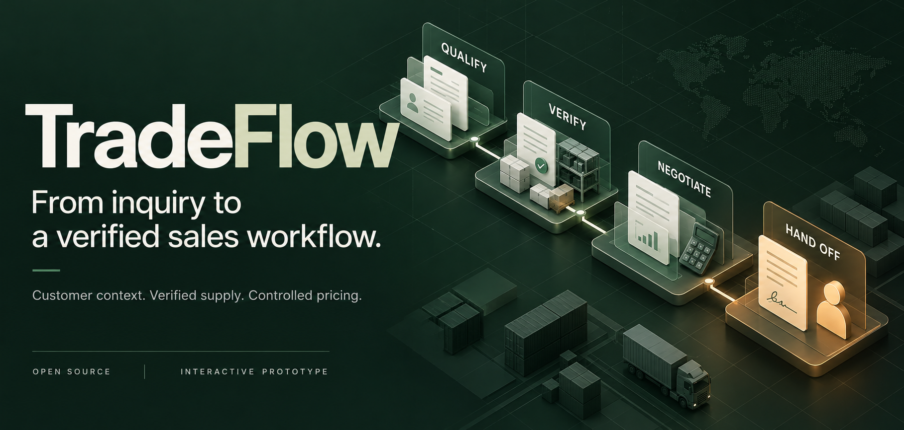
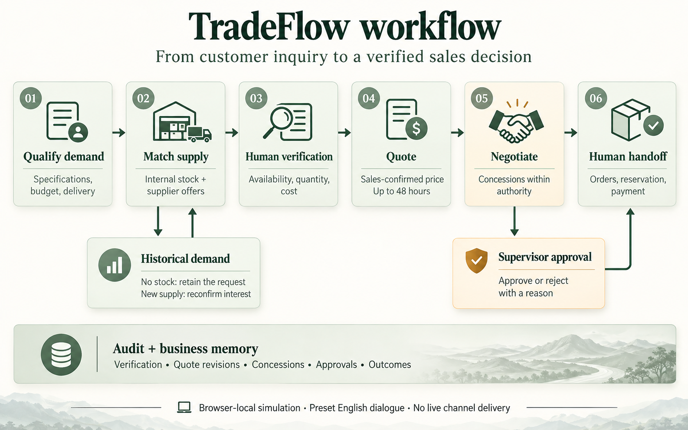
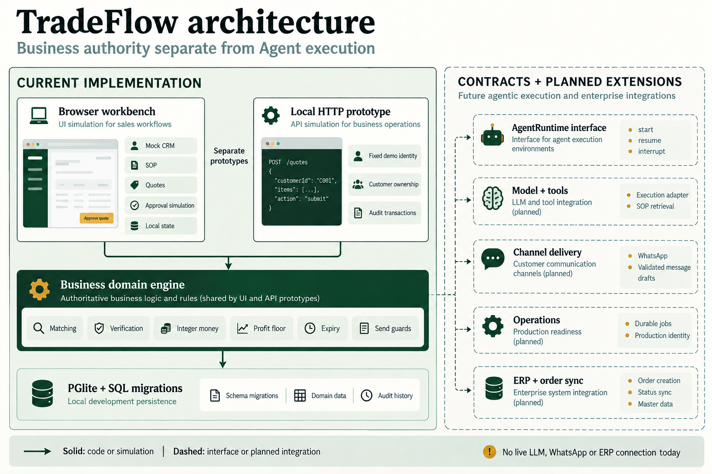

<p align="center"></p>

<p align="center">
  <a href="https://github.com/xliang-L/trade-ai-agent/actions/workflows/check.yml"></a>
  <a href="LICENSE"></a>
  
  
</p>
<p align="center"><b>English</b> · <a href="README.zh-CN.md">简体中文</a></p>
<p align="center"><a href="#the-workflow">Workflow</a> · <a href="#architecture">Architecture</a> · <a href="#try-it-locally">Quick start</a> · <a href="docs/demo-walkthrough.md">Demo guide</a></p>

# TradeFlow

**A sales operations workbench for cross-border phone and 3C trading.**

Turn scattered inquiries and supplier offers into a traceable pipeline: qualify demand, compare supply, verify availability, quote within policy, negotiate within authority, and hand the deal to a salesperson.

Customer context, internal stock, supplier offers, historical demand and commercial decisions meet in one workflow. Every step has a next action and an owner.

> **Status:** an interactive browser-local demo, a tested TypeScript quote engine, and a separate local persistence/API prototype. Conversations and delivery are simulated. Live LLMs, WhatsApp, production authentication and ERP are not connected.

## Why TradeFlow

| Business problem | The workflow |
| --- | --- |
| Stock arrives after the customer has moved on. | Keep historical demand, match new supply and reconfirm interest. |
| Several suppliers quote the same model. | Compare independent offers; exclude expired or insufficient stock. |
| Sales need flexibility without uncontrolled discounting. | Separate target price, quoted price, internal floor and concession authority. |
| A conversation becomes an order. | Hand over context, require human decisions and record the outcome. |

## The workflow



1. **Understand demand.** Read customer context and confirm missing specifications, quantity, budget and delivery requirements.
2. **Match and verify.** Compare internal and supplier stock. Procurement confirms the source, quantity and current cost.
3. **Quote and negotiate.** Generate a time-bounded quote; allow concessions within policy and escalate exceptions to a supervisor.
4. **Hand over and learn.** Sales handle purchase intent, reservation and payment. Record the outcome; retain unfulfilled demand for the next matching opportunity.

**A concrete demo:** 200 iPhone 13 units → USD 285/unit → authorized concession to USD 284 → a request for USD 283 triggers supervisor review. Availability, expiry and the internal floor remain constraints. These amounts are illustrative configuration, not a recommended pricing policy.

## Architecture



**Commercial authority and Agent execution are separate.** The domain engine owns quote arithmetic and validity checks. `AgentRuntime` describes start, resume, interrupt and action proposals; it does not grant authority to approve stock, collect payment or bypass business rules.

The diagram shows logical modules, not a fleet of deployed microservices. Solid blocks identify current code or browser simulation; dashed blocks identify future integrations.

| Surface | Available today |
| --- | --- |
| Workbench | Mock CRM, supply comparison, SOP qualification, verification, quotes, preset English dialogue, bounded concessions, approval and outcome simulation. |
| Business core | Typed matching, integer money, profit checks, expiry and send guards shared by the demo and local prototype. |
| Persistence/API | PGlite, SQL migration, customer ownership checks and audit transactions. Separate from the browser demo, not its backend. |
| Runtime/integrations | Runtime interfaces and architecture only. Live models, durable task orchestration, WhatsApp and ERP are planned. |

## Try it locally

Requires **Node.js 24** and **pnpm 11.25.0**. No API key is needed for the demo.

```sh
git clone https://github.com/xliang-L/trade-ai-agent.git
cd trade-ai-agent
pnpm install --frozen-lockfile
pnpm build:demo
pnpm dev:demo
```

Open **http://127.0.0.1:4173**, or open the generated **`artifacts/TradeFlow-demo.html`** directly in a browser for an offline presentation.

Choose **演示完整业务流程** on the dashboard. Use **演示说明 → 重置模拟数据** to restart. The interface is Chinese; customer-facing preset conversations are English.

```sh
pnpm typecheck
pnpm test
pnpm demo       # CLI quote-engine example
pnpm dev:api    # separate local API prototype on 127.0.0.1:3000
```

The API uses a fixed demo identity and is intended for loopback development. See [development notes](docs/development.md).

## Project structure

```text
apps/
  web/demo/          Browser workbench and scenario model
  api/               Local HTTP prototype
  agent-worker/      CLI domain-workflow example
packages/
  domain/            Matching, pricing and send guards
  database/          Store and SQL migrations
  contracts/         Agent runtime interfaces
tests/
  unit/              Quote-domain tests
  integration/       Persistence and HTTP tests
  demo/              Scenario and offline-build tests
scripts/             Demo build and preview tools
docs/
  assets/            Cover, workflow and architecture visuals
  adr/               Architecture decisions
  requirements/      Requirement baseline and source extract
artifacts/           Generated output; ignored by Git
```

## Roadmap

- **V1 · Verify the sales loop:** demo and domain prototype today; real identity, knowledge, model execution and WhatsApp next.
- **V2 · Grow the pipeline:** segmented follow-up, social content, lead routing and operational metrics.
- **V3 · Connect operations:** ERP, inventory/order synchronization, unified channels and supplier intelligence.

Read the [architecture](docs/architecture.md), [roadmap](docs/roadmap.md) and [current requirement gaps](docs/requirements-demo-review.md).

## Contributing

Start with an issue describing the business scenario and expected behavior. Keep changes within existing app/package boundaries, include relevant verification, and use synthetic data. See [development](docs/development.md) and [Git workflow](docs/git-workflow.md).

## Design references

README presentation and architectural framing were informed by [Twenty](https://github.com/twentyhq/twenty), [Chatwoot](https://github.com/chatwoot/chatwoot) and [LangGraph](https://github.com/langchain-ai/langgraph). They are independent projects, not dependencies or integrations; no code or visual assets were copied from them.

## License

[MIT](LICENSE) · Copyright © 2026 TradeFlow contributors. Third-party dependencies retain their own licenses.
