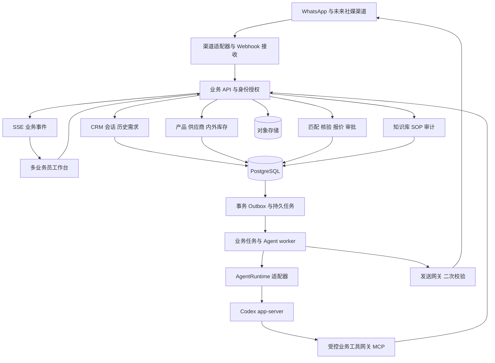
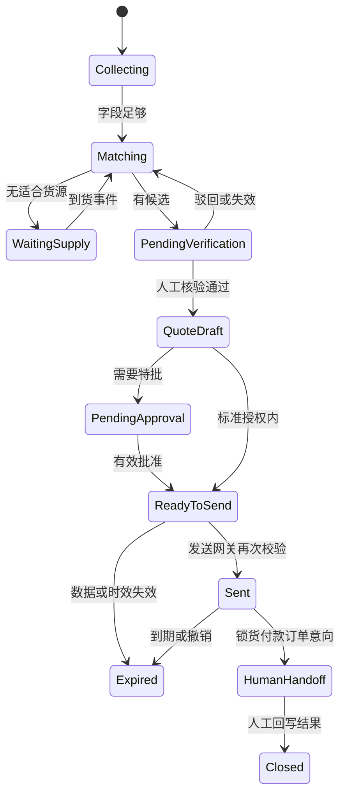

# 外贸 AI Agent 总体架构

建议用模块化单体业务后端、独立 Agent worker、PostgreSQL 和对象存储建立第一版。业务数据库是客户、货源、核验、报价和审批的事实来源；harness 管理模型运行和会话上下文。后续三阶段沿同一业务模型扩展。

## 系统拓扑

第一版 API 与业务模块作为同一服务部署；worker 和 Codex 子进程独立部署与限制资源。图中的模块不是必须分别部署的微服务。发送网关是后端内部边界，模型不能直接调用渠道供应商 API。

## 技术栈建议

- TypeScript 贯穿前后端；React 工作台，后端建议 NestJS，Agent worker 使用 Node.js。具体框架在开发骨架阶段锁定版本。
- PostgreSQL 存交易数据、任务、Outbox、审计和知识版本；第一版搜索先用结构化过滤与全文检索，语义检索有需求再引入 pgvector。
- S3 兼容对象存储保存产品图、附件、导入原件；数据库保存元数据、权限与校验和。
- 第一版持久任务使用 PostgreSQL 任务表加租约与重试，无需立即增加 Redis、Kafka 或 Temporal。未来任务量和跨系统长流程证明有必要后，再替换队列适配器。
- Docker Compose 用于开发，生产采用受管理数据库加容器服务，独立备份和恢复演练。无当前规模信息，暂不预设 Kubernetes。

这是面向项目的建议，尚未完成依赖兼容性与性能验证。

## 模块与归属

| 模块 | 第一版职责 | 后续扩展 |
|---|---|---|
| Identity | 组织、用户、角色、团队、客户负责人、字段授权 | 更细的授权与外部协作 |
| Catalog | 规范 SKU、别名、品牌、版本、容量、颜色、可售市场 | ERP 产品映射 |
| Supply | 供应商、外部货源历史、内部数量与锁定数量 | 履约评分、仓库同步 |
| CRM | 客户画像、渠道身份、归属、历史需求 | 去重合并、多渠道身份 |
| Conversation | 消息入库、意图、AI/人工模式、会话顺序 | 统一收件箱 |
| Matching | 硬条件过滤、候选排序、原因、置信度 | 偏好排序、预测 |
| Verification | 核验任务、核验数量与底价、版本绑定 | ERP 联动核验 |
| Quote | 精确金额计算、规则快照、有效期、审批 | 配置化审批链 |
| Knowledge | 公司共享知识、SOP 发布版本、访问控制 | 多语言与质检 |
| Agent | 上下文装配、运行、工具授权、草稿 | 不同场景 Agent 配置 |
| Delivery | 草稿、批准、发送校验、回执、重试 | 主动维护、社媒发布 |
| Operations | 任务、Outbox、审计、运行成本 | KPI、调度、内容排期 |

## 数据模型

所有业务记录带 `organization_id`、创建和更新时间、必要的 `version`；跨表关联也须校验组织一致。金额使用 decimal 或最小货币单位，不用浮点数；时间使用 UTC 存储、界面按业务时区显示。

| 实体 | 关键关系和约束 |
|---|---|
| User / Team / CustomerAssignment | 一个客户当前主负责人，变更留历史；角色与客户访问范围分开 |
| Customer / ChannelIdentity | 渠道账号映射客户；组织、渠道、外部身份唯一；合并需人工确认与审计 |
| ProductVariant / ProductAlias | 品牌、型号、地区版本、容量、颜色规范化；别名待确认不能默认为同款 |
| Supplier / SupplierOffer / OfferRevision | 同 SKU 多供应商多货源；价格和数量变化追加修订，不覆盖历史证据 |
| InventoryLot / StockReservation | 内部库存独立建模；可售数以在库减有效锁定为准；锁货只允许人工业务流程 |
| Demand / DemandRevision | 客户需求、数量、目标市场和价格、替代许可、状态及未成交原因 |
| Conversation / Message | 消息唯一键为组织、渠道、渠道消息 ID；人工接管版本及消息顺序号 |
| MatchCandidate | 绑定需求版本与货源版本，保留硬条件、替代原因、分数和生成时间 |
| Verification | 核验人、货源版本、数量、币种、底价、适用客户或需求、截止时间、撤销状态 |
| Quote / QuoteLine / PricingRuleVersion | 需求、货源、核验、币种、数量、成本与规则快照；对客户输出单独 DTO |
| Approval / HandoffTask | 审批范围、批准人、原因、报价版本与内容哈希；修改后批准失效 |
| KnowledgeDocument / KnowledgeVersion | 草稿与已发布版本；责任人、生效期、角色范围、来源 |
| AgentRun / AgentEvent / RuntimeBinding | 业务 run ID 映射 provider thread/turn ID；不将运行时 ID 当业务主键 |
| Task / OutboxEvent / InboxReceipt | 租约、重试、幂等键、事件版本、关联 ID、失败原因 |
| MessageDraft / DeliveryAttempt / AuditEvent | 草稿内容哈希、授权范围、发送状态和渠道回执；审计脱敏并限制修改权限 |

第一版建立业务表，未来 CRM 长期记忆由结构化画像与已确认事实组成，不把单个 Codex thread 或向量库当客户数据库。

## 匹配与报价规则

先过滤过期、失效、不可信、数量不足和不可售区域等货源；地区版本、容量、颜色是业务属性，不允许模型把不同版本混为同款。替代匹配必须标为替代候选，客户接受后才进入该候选正式报价。成本、履约、仓库等排序保留可解释因素；分数不是库存真实性证明。

报价引擎按已发布规则执行固定加价、客户等级与数量阶梯，明确规则优先级、冲突处理、最低利润和舍入方式。不同币种没有核准汇率就不自动比价或报价；税费、物流与付款条件不明时明确待补充。

`quote.expires_at = min(报价时间 + 配置有效期, 核验截止时间, 外部货源有效期)`；内部库存用核验截止时间和实时可售状态校验。货源数量、成本、状态或规则发生影响报价的变化时，失效或重新核验，不静默沿用旧报价。

## 状态与人工边界

这是报价流程视图，需求状态、会话状态与任务状态独立保存。基础报价生成需要人工核验；标准报价是否允许 AI 自动发送由组织配置决定。初始建议开启草稿审核模式，日后明确授权后可自动发送授权范围内话术。任何最终下单、锁货、收款、发票和争议必须人工接管。

人工接管通过事务更新会话模式和控制版本，取消或中断 Agent run；发送网关在最终提交时检查版本与模式。人工释放后才能恢复 AI。不能仅靠模型收到“停止”来防止并发误发。

## Harness 与业务之间的契约

`AgentRuntime` 提供 start、resume、interrupt 和事件流。统一事件包括文本进度、工具请求、运行结束、运行失败；对外消息只能来自 `MessageDraft` 的业务确认流程。初步契约见 `packages/contracts/agent-runtime.ts`，不是已完成 SDK 实现。

建议工具：`customer.get_context`、`demand.upsert_draft`、`supply.search`、`match.create_candidates`、`verification.request`、`quote.calculate_draft`、`message.propose_draft`、`handoff.request`。核验完成、主管批准、库存锁定、收款不作为 AI 可执行工具。工具由网关注入组织、业务员或服务身份，模型参数不能自行改变身份与权限。

客户侧 Agent 只接收可售条件与客户价；受权限控制的内部报价服务计算成本和利润，不把供应商联系人、成本底价混入客户回复上下文。内部业务员 Agent 的字段权限仍依据调用人的身份，不能因 Agent 是服务账号而读取全部数据。

## 可靠性与发送

Webhook 验证渠道签名，先落库再确认接收；重复消息按唯一键去重，乱序按渠道时间与业务顺序处理。每个会话同时只允许一个有效 AI turn。接收消息与 Outbox 同一事务提交。

worker 使用有到期时间的任务租约、心跳、指数退避和失败队列。外部副作用至少一次投递，不能承诺 exactly-once。发送键绑定草稿版本、会话与用途；渠道支持幂等键时传递，不支持时遇到“请求超时但可能已发送”先查询回执或转人工处理，避免盲目重发。

发送前检查会话仍是 AI 模式、草稿未变、审批未过期、核验和货源仍有效、报价未到期、触达策略与渠道能力允许。检查与发送授权记录在事务内完成，渠道请求在事务外；失败后以相同授权和幂等键恢复。外部库存仍可能在核验后变化，因此报价注明有效条件，成交前由人工最终确认。

运行被中断或 worker 重启后，先恢复业务任务与已执行工具记录，再决定继续运行或创建新 thread；不能简单重放整段对话导致重复动作。所有工具写入带业务幂等键。

## 共享、多业务员与安全

知识库和货源按公司共享；客户、会话与任务按角色、团队、负责人过滤。需要 DB 行级策略或等效强制仓储过滤，并测试横向越权；供应商联系人、成本、利润单独字段权限与响应 DTO。

每个执行上下文绑定组织、调用人、可访问客户、工具集合和上下文版本。客户消息、附件、网页和导入资料当不可信数据，不能成为权限指令。禁用不需要的 shell 与计算机操作，限制 worker 网络和文件系统，仅允许必要业务工具。

密钥由部署环境或 secret manager 注入；日志不存明文 token。审计记录操作者、动作、关联 run、前后版本和批准理由；客户数据删除保留必要的脱敏审计。生产部署前定义留存策略、备份 RPO/RTO 并演练恢复，不虚构当前业务要求。

## 演进路径

V2 添加 Campaign、ContactPolicy、ContentDraft、Publication、审批模板和 KPI 投影，通过 `SupplyChanged`、`DemandMatched`、`QuoteSent` 等业务事件驱动。触达按客户统一去重、人工归属、时区、频率和明确的渠道许可检查。

V3 增加 IntegrationMapping、SyncCursor、ExternalRecordVersion、冲突队列与身份合并记录；为每类字段规定 ERP 或本系统的权威来源。先处理订单和库存同步的幂等与冲突，再建设预测，预测不能跳过核验。

只有当部署独立性、任务吞吐或团队边界有实际需求时拆分匹配、发布或集成服务。第一版预留接口与事件，不提前实现全部未来功能。
